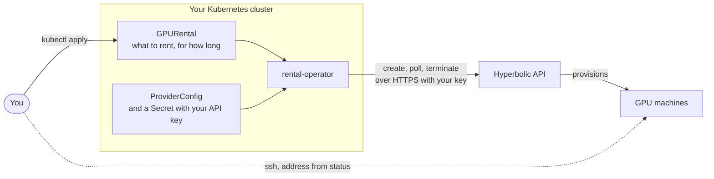

<p align="center">
  <a href="https://hyperbolic.ai">
    <picture>
      <source media="(prefers-color-scheme: dark)" srcset=".github/assets/HYP-Logo-Full-Light.svg">
      <source media="(prefers-color-scheme: light)" srcset=".github/assets/HYP-Logo-Full-Dark.svg">
      
    </picture>
  </a>
</p>

# rental-operator

[](https://github.com/HyperbolicLabs/rental-operator/actions/workflows/test.yml)
[](https://github.com/HyperbolicLabs/rental-operator/releases)
[](LICENSE)

Rent [Hyperbolic](https://hyperbolic.ai) on-demand GPUs from your own Kubernetes cluster, declaratively.

Drop your Hyperbolic API key into a `Secret`, `kubectl apply` a `GPURental`, and the operator provisions the GPUs against the Hyperbolic public API, keeps them reconciled, and surfaces the SSH/connection details on the resource's status. Delete the object and the rental is terminated and the GPUs released.

```yaml
apiVersion: compute.hyperbolic.ai/v1alpha1
kind: GPURental
metadata:
  name: train-run-42
spec:
  providerConfigRef: { name: default }
  gpuType: h100
  gpuCount: 8
```

```console
$ kubectl get gpurentals
NAME           PHASE     GPU    COUNT   REGION         CENTS/HR   RENTAL-ID      RENTAL-NAME                    AGE
train-run-42   Running   h100   8       us-central-1   2200       B-k3Qm7vXa2P   conscious-bougainvillea-oryx   6m
```

It is built to never spend money you didn't ask for: a create is never retried blindly (so a timeout can't rent twice), and a rental is never deleted from the cluster while it may still be billing.

---

## Project status

rental-operator is at v0.1, its first public release. The API is `compute.hyperbolic.ai/v1alpha1`, so fields may still change in a minor release, and the release notes call out each change with migration steps. [SUPPORT.md](SUPPORT.md) lists the supported releases and Kubernetes versions. [API versioning](docs/api-versioning.md) explains what each API version promises.

## How it works

The operator is a controller in your cluster that calls the Hyperbolic public API with your API key, the same way you would. It keeps no state of its own: everything durable lives on the custom resources or at Hyperbolic.



Five custom resources, all in the `hyperbolic` category (`kubectl get hyperbolic -A`):

- **`ProviderConfig`** points at the labeled `Secret` holding your API key, validates it, and reports your account's balance, active rentals and hourly cost as Hyperbolic reports them.
- **`ClusterProviderConfig`** does the same for a key a platform team shares across namespaces. Its Secret stays in the operator's namespace.
- **`GPURental`** is one on-demand rental. The operator creates it, polls it to Running, publishes SSH details on status, and on delete terminates it and waits until Hyperbolic confirms it is gone.
- **`GPUAvailability`** is a filtered, always-fresh view of what your account can rent.
- **`SSHKey`** saves an SSH public key on your account, so GPURentals can authorize it by name, and deletes it again with the object.

[Architecture](docs/architecture.md) shows the GPURental lifecycle and how creates and deletes stay safe when the API times out, the operator restarts or a namespace is deleted.

## Quickstart

You need Kubernetes 1.35 to 1.37, [Helm](https://helm.sh) 3, a Hyperbolic API key from the [dashboard](https://app.hyperbolic.ai), and an SSH public key. See [Install](docs/install.md) for the namespaced install, upgrades and uninstalling.

```console
helm install rental-operator \
  oci://ghcr.io/hyperboliclabs/charts/rental-operator --version X.Y.Z \
  --namespace rental-operator-system --create-namespace
```

1. **Store your API key** (in whatever namespace your rentals will live in):

   ```console
   read -rs HYPERBOLIC_API_KEY   # paste the key; it is not echoed or kept in shell history
   kubectl create secret generic hyperbolic-key \
     --from-literal=api-key="$HYPERBOLIC_API_KEY"
   kubectl label secret hyperbolic-key compute.hyperbolic.ai/credentials=true
   unset HYPERBOLIC_API_KEY
   ```

   The operator only reads Secrets with that label, so it never holds the rest of your cluster's Secrets in memory.

   If you manage Secrets declaratively, for example with External Secrets or Sealed Secrets, put the label in the Secret's metadata:

   ```yaml
   metadata:
     name: hyperbolic-key
     labels:
       compute.hyperbolic.ai/credentials: "true"
   ```

2. **Create a ProviderConfig:**

   ```yaml
   apiVersion: compute.hyperbolic.ai/v1alpha1
   kind: ProviderConfig
   metadata:
     name: default
   spec:
     credentials:
       secretRef:
         name: hyperbolic-key
         key: api-key
   ```

   Check it authenticated:

   ```console
   $ kubectl get providerconfig default
   NAME      ENDPOINT                    BALANCE   CENTS/HR   RENTALS   READY   AGE
   default   https://api.hyperbolic.ai   124035    0          0         True    5s
   ```

3. **Save your SSH key** on the account:

   ```console
   kubectl apply -f - <<EOF
   apiVersion: compute.hyperbolic.ai/v1alpha1
   kind: SSHKey
   metadata:
     name: me
   spec:
     providerConfigRef: { name: default }
     publicKey: $(cat ~/.ssh/id_ed25519.pub)
   EOF
   ```

   If the account already has this key, the SSHKey adopts it and never deletes it.

4. **Rent GPUs:**

   ```yaml
   apiVersion: compute.hyperbolic.ai/v1alpha1
   kind: GPURental
   metadata:
     name: train-run-42
   spec:
     providerConfigRef: { name: default }
     gpuType: h100
     gpuCount: 8
     sshKeyRefs:
       - name: me
   ```

   ```console
   $ kubectl get gpurental train-run-42 -w
   ```

5. **Get your SSH connection** once it's Running:

   ```console
   $ kubectl get gpurental train-run-42 -o jsonpath='{.status.instances[*].ssh}'
   root@144.202.10.31:22
   ```

6. **Release the GPUs** by deleting the object:

   ```console
   $ kubectl delete gpurental train-run-42
   ```

   The object stays (with phase `Terminating`) until Hyperbolic confirms the rental is gone, so you are never left paying for GPUs with nothing in the cluster pointing at them.

> [!IMPORTANT]
> Before you delete the cluster, delete your GPURentals first. `kind delete cluster`, or losing a cluster any other way, removes the operator too. Nothing is left to terminate the rentals, and they keep billing until you terminate them in the [dashboard](https://app.hyperbolic.ai).

## Documentation

| | |
|---|---|
| [Architecture](docs/architecture.md) | Components, the GPURental lifecycle, the create and delete guarantees, polling and API budget. |
| [Install, upgrade and uninstall](docs/install.md) | Cluster-wide and namespaced installs, verifying a release, CRD upgrades. |
| [Custom resources](docs/resources.md) | What each field does, and the conditions and reasons. |
| [Common operations](docs/operations.md) | Regions, ports, terminating, orphaning, rebooting. |
| [Observability](docs/observability.md) | Prometheus metrics and the alerts the chart ships. |
| [API reference](docs/reference/api.md) | Every field, generated from the Go types. |
| [API versioning](docs/api-versioning.md) | What `v1alpha1` promises and how the API will graduate. |
| [Development](docs/development.md) | Running the operator locally. |
| [Releases](RELEASE.md) | Versioning, what a release contains, how one is cut. |
| [Support](SUPPORT.md) | Getting help, supported releases and Kubernetes versions. |
| [Releases](https://github.com/HyperbolicLabs/rental-operator/releases) and [roadmap](ROADMAP.md) | What changed and what comes next. |

## Limitations

- **A saved key becomes the account's default.** A rental created without naming keys gets the account's newest key, or under an organization, the organization's newest key. Saving a key with an SSHKey makes it that key, for teammates' rentals too. Name keys in `sshKeyRefs` rather than relying on the default.
- **The operator must be running to end a rental.** Deleting the cluster or uninstalling the operator leaves rentals billing. Delete GPURentals first.
- **On-demand only.** Reserved-term rentals (prepaid commitments) are out of scope.
- **Polling.** The API has no push notifications, so status is poll-driven (about 10s while provisioning, 60s once running). All GPURentals on one account share one list of rentals per interval, so a hundred rentals cost the same API budget as one.

## Security

Your API key stays in a `Secret` you control. The operator caches only Secrets labeled `compute.hyperbolic.ai/credentials=true`, sends the key only to the configured Hyperbolic endpoint over HTTPS, and never logs it or writes it to status. Outside the cluster it only calls the configured Hyperbolic endpoint, and its blast radius is exactly what your API key can already do. See [Credentials](docs/architecture.md#credentials) and, for least privilege, the [namespaced install](docs/install.md#namespaced-install).

Report vulnerabilities privately, as [SECURITY.md](SECURITY.md) describes.

## Local development

To try a change, run the operator on a local [kind](https://kind.sigs.k8s.io) cluster with an image you built:

```console
kind create cluster
make docker-build IMG=rental-operator:dev
kind load docker-image rental-operator:dev
helm install rental-operator ./charts/rental-operator \
  --namespace rental-operator-system --create-namespace \
  --set image.repository=rental-operator --set image.tag=dev \
  --set image.pullPolicy=IfNotPresent
```

A local cluster still rents real GPUs with your key, so delete your GPURentals before `kind delete cluster`. [docs/development.md](docs/development.md) also covers running the controller out of cluster and seeing its metrics locally, and [CONTRIBUTING.md](CONTRIBUTING.md) covers the tests and checks to run before opening a pull request.

## Community

- Ask questions and share ideas in [GitHub Discussions](https://github.com/HyperbolicLabs/rental-operator/discussions).
- Report bugs and request features in [issues](https://github.com/HyperbolicLabs/rental-operator/issues/new/choose).
- Using rental-operator? Add your organization to [ADOPTERS.md](ADOPTERS.md).

Contributions are welcome. [CONTRIBUTING.md](CONTRIBUTING.md) explains how to get started, and everyone taking part follows the [code of conduct](CODE_OF_CONDUCT.md). [GOVERNANCE.md](GOVERNANCE.md) explains how decisions are made and how contributors become [maintainers](MAINTAINERS.md). The [roadmap](ROADMAP.md) shows what comes next.

For commercial support, contact Hyperbolic at [support@hyperbolic.ai](mailto:support@hyperbolic.ai).

---

Licensed under the [Apache License 2.0](LICENSE).
