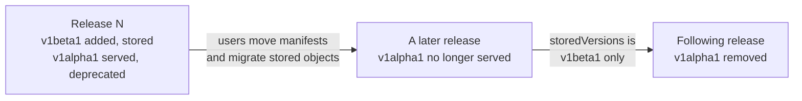

# API versioning

The custom resources are served as `compute.hyperbolic.ai/v1alpha1`. This page says what each API version promises, what it takes to move to the next one, and how you upgrade a cluster when that happens. Release numbers (`0.1.0`, `0.2.0`) are a separate scheme, described in [RELEASE.md](../RELEASE.md).

- [What each version promises](#what-each-version-promises)
- [When the API graduates](#when-the-api-graduates)
- [How a new version is rolled out](#how-a-new-version-is-rolled-out)
- [Upgrading your cluster across versions](#upgrading-your-cluster-across-versions)

## What each version promises

| Version | Breaking changes | When an older version goes away |
|---|---|---|
| `v1alpha1` (today) | Allowed in any minor release. Each one is called out in the [release notes](https://github.com/HyperbolicLabs/rental-operator/releases) with migration steps. Existing objects are not converted for you. | When `v1beta1` ships, `v1alpha1` is deprecated, and it is removed in a later minor release. |
| `v1beta1` | Not within the version: fields are added, never removed, renamed or given a new meaning. A breaking change needs a new version, and objects convert between versions automatically. | Served, with a deprecation warning, for at least three minor releases after its successor ships. |
| `v1` | Not until `v2`. | Not removed within the major version. |

Patch releases never change the CRD schema. Within any version, a field's default does not change in a patch release, and validation is tightened only when the old rule accepted values the operator could not act on.

## When the API graduates

The API graduates to `v1beta1` after real production use, a release with no breaking changes, and server-side protection or proven mitigations against renting twice and leaking rentals.

## How a new version is rolled out

For maintainers. Kubernetes serves every version listed in a CRD, stores each object in exactly one of them (the *storage version*), and records in `status.storedVersions` every version objects may still be stored in. A version can only be removed from the CRD once it is gone from that list. The Kubernetes guide is [Versions in CustomResourceDefinitions](https://kubernetes.io/docs/tasks/extend-kubernetes/custom-resources/custom-resource-definition-versioning/).



1. **Add the version.** Add `api/v1beta1` and mark its types `// +kubebuilder:storageversion`. Keep `v1alpha1` served and mark its types deprecated, naming the replacement:

   ```go
   // +kubebuilder:deprecatedversion:warning="compute.hyperbolic.ai/v1alpha1 GPURental is deprecated; use compute.hyperbolic.ai/v1beta1 GPURental"
   ```

   Every `kubectl` call against the old version then prints that warning.
2. **Convert.** If the two schemas are identical, the CRD's default `None` conversion is enough. If they differ, `v1beta1` becomes the hub (controller-runtime's `conversion.Hub`), `v1alpha1` implements `conversion.Convertible`, and the manager serves a conversion webhook, which needs a serving certificate the chart must provide. Round-trip tests cover every field.
3. **Document.** The pull request description lists the field changes and links to [the upgrade steps below](#upgrading-your-cluster-across-versions), and the release notes link to the pull request. The README, docs and samples move to the new version.
4. **Stop serving** the old version, no sooner than the window in the table above, with `// +kubebuilder:unservedversion`. The release notes tell users to finish migrating stored objects first.
5. **Remove** the old version's types in a later release.

## Upgrading your cluster across versions

1. Read the [release notes](https://github.com/HyperbolicLabs/rental-operator/releases) for the release.
2. Apply the new CRDs, then upgrade the chart, as in [Upgrade](install.md#upgrade). Running rentals are not affected.
3. Change `apiVersion` in your manifests (a GitOps repository, Helm values, scripts) to the new version. Deprecation warnings from `kubectl` and your GitOps tool show what is left.
4. Before upgrading to the release that stops serving the old version, rewrite the stored objects in the new storage version, using one of:

   - **Storage Version Migration**, on clusters where the `StorageVersionMigrator` feature is enabled (check your Kubernetes version's documentation): create one `StorageVersionMigration` per resource. Kubernetes updates `status.storedVersions` when it finishes.

     ```yaml
     apiVersion: storagemigration.k8s.io/v1
     kind: StorageVersionMigration
     metadata:
       name: gpurentals-migration
     spec:
       resource:
         group: compute.hyperbolic.ai
         resource: gpurentals
     ```

   - **Rewrite every object**, on any cluster. Reading and writing back each object unchanged makes the API server store it in the current storage version. A conflict error means the operator updated that object in between, so run the command again.

     ```console
     for r in gpurentals providerconfigs gpuavailabilities sshkeys; do
       kubectl get "$r.compute.hyperbolic.ai" -A -o json | kubectl replace -f -
     done
     kubectl get clusterproviderconfigs.compute.hyperbolic.ai -o json | kubectl replace -f -
     ```

     Then record that only the new version is stored, here `v1beta1`:

     ```console
     for r in gpurentals providerconfigs clusterproviderconfigs gpuavailabilities sshkeys; do
       kubectl patch crd "$r.compute.hyperbolic.ai" --subresource=status --type=merge \
         -p '{"status":{"storedVersions":["v1beta1"]}}'
     done
     ```

5. Check that every CRD lists only the new version:

   ```console
   kubectl get crd -o custom-columns=NAME:.metadata.name,STORED:.status.storedVersions | grep hyperbolic
   ```
