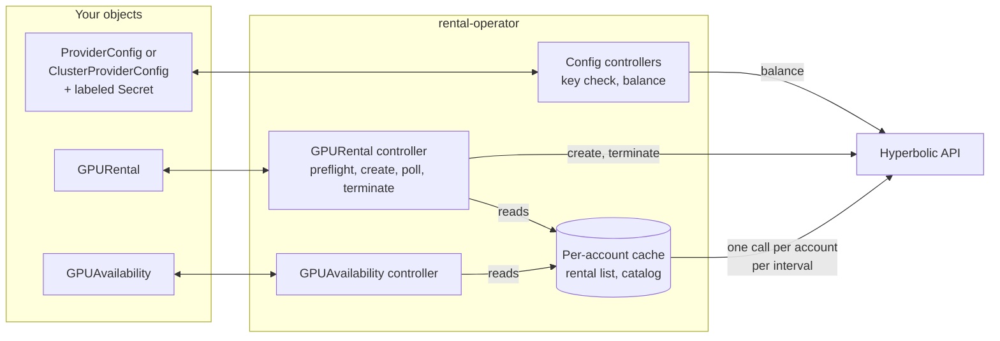
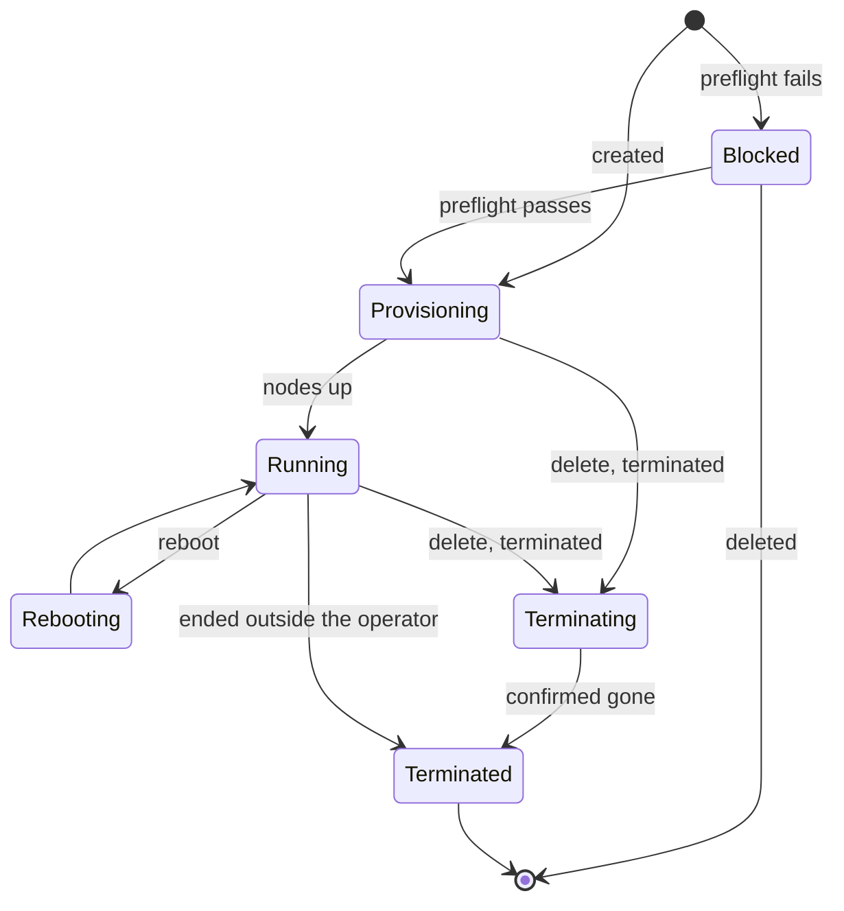
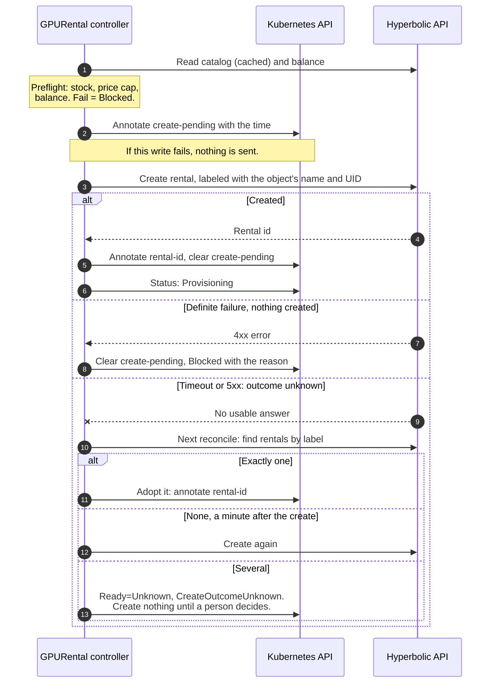
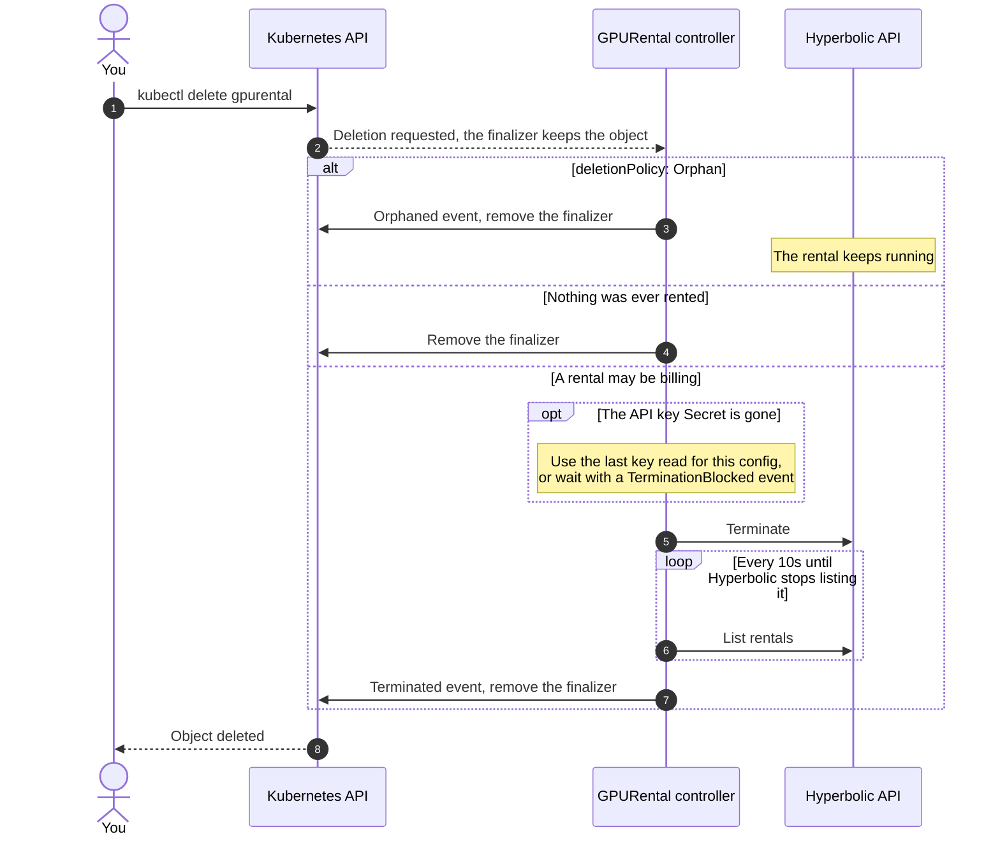

# Architecture

rental-operator is a Kubernetes controller that rents Hyperbolic on-demand GPUs through the public REST API, using your API key the way any customer would. It keeps no state of its own: everything durable lives on the custom resources, in their annotations and status, or server-side at Hyperbolic. Restarting or upgrading the operator loses nothing.

- [Components](#components)
- [GPURental lifecycle](#gpurental-lifecycle)
- [Creating a rental: never rent twice](#creating-a-rental-never-rent-twice)
- [Deleting a rental: never leak](#deleting-a-rental-never-leak)
- [Polling and API budget](#polling-and-api-budget)
- [Credentials](#credentials)

## Components

The manager runs four controllers:

| Controller | Watches | Does |
|---|---|---|
| ProviderConfig | ProviderConfigs, labeled Secrets, GPURentals | Checks the API key, shows the account's balance and active rental summary as the API reports them, and holds the `in-use` finalizer while rentals still need the key. |
| ClusterProviderConfig | ClusterProviderConfigs, labeled Secrets in the operator's namespace, GPURentals | The same for a cluster-scoped config, plus `allowedNamespaces`. |
| GPURental | GPURentals | Preflight, create, poll, reboot, terminate. Everything that spends money. |
| GPUAvailability | GPUAvailabilities | Filters the account's catalog into status. |

Each controller acts on what it observes on the object and the API, not on the event that woke it, so a missed or repeated event never changes the outcome.

## GPURental lifecycle

`status.phase` is for people reading `kubectl get`. Automation should read the `Ready` and `Synced` conditions. See [Status and conditions](resources.md#status-and-conditions).

- **Provisioning** to **Running** is when billing starts. A rental ends through `kubectl delete` or `spec.terminated: true`. Bumping `spec.rebootGeneration` reboots it.
- **Blocked** means nothing was rented and nothing is billing. The reason on `Ready` says why (no stock, over the price cap, low balance, no SSH key). The operator retries every 5 minutes, and immediately when you change the spec.
- **Terminated** is final. The object stays as a read-only record when the rental ended because of `spec.terminated` or something outside the operator. It is never rented again. Create a new GPURental. When the rental ended because you deleted the object, the object goes away once Hyperbolic confirms the rental is gone.
- **Failed** and **Unknown** come from Hyperbolic's own status for the rental, or from a create whose outcome cannot be settled (`CreateOutcomeUnknown`).

## Creating a rental: never rent twice

A create that times out or fails with a 5xx may still have rented the GPUs. Retrying it blindly is how a cluster ends up paying for two rentals, so the operator records its intent before it sends anything and settles an unknown outcome by looking the rental up instead of creating again.

- The rental id is written to an annotation before status, because an annotation survives a failed status write. If even that write fails, the next reconcile finds the rental by its label.
- The label is `<metadata.name>-<6 characters of the UID>`, or `spec.displayName`. The UID part keeps it unique when objects reuse a name.
- A rental is adopted only if its GPU type, count and region match the spec, so a stranger's rental with the same dashboard name is never taken over.

## Deleting a rental: never leak

A GPURental carries the finalizer `compute.hyperbolic.ai/terminate`. Kubernetes keeps the object until the operator removes it, and the operator removes it only when nothing can still be billing.

- "May be billing" includes a create whose outcome is still unknown. The operator first finds that rental by label.
- `kubectl delete namespace` deletes the Secret and the ProviderConfig alongside the rentals. The operator still terminates them with the last key it read for that config, and the ProviderConfig's `in-use` finalizer keeps the config until its rentals are gone.
- If the operator cannot terminate (the key is gone and it never read it, or several rentals carry the label), the object stays in `Terminating` with a Warning event that says how to proceed. A stuck finalizer is cheaper than a GPU billing with nothing pointing at it.
- The operator must be running for any of this. Deleting the cluster or uninstalling the operator first leaves rentals billing.

## Polling and API budget

The Hyperbolic API has no push notifications, so status is poll-driven.

| What | How often | Shared |
|---|---|---|
| Rental status | 10s while any rental on the account is provisioning, 60s otherwise | One list of rentals per account per interval, whatever the number of GPURentals |
| Catalog (rental options) | `--catalog-refresh-interval`, default 5m | One query per account per interval, for every GPUAvailability and preflight |
| Balance and active rental summary | Every 10 minutes, and when a GPURental using the config is created or ends | One read of each per config |

A list that was in flight while a rental was created or terminated is discarded, and a rental missing from a cached list is re-checked with a fresh read before it is marked as ended. A failed poll never marks a running rental as gone: it sets `Synced=False` and retries in 30s.

## Credentials

- The operator caches only Secrets labeled `compute.hyperbolic.ai/credentials=true`. Kubernetes RBAC cannot grant access by label, so in the default cluster-wide install its role can still read any Secret. The [namespaced install](install.md#namespaced-install) removes that access.
- A ClusterProviderConfig reads its Secret from the operator's own namespace, as cert-manager's ClusterIssuer does, so creating one never grants access to Secrets elsewhere.
- The key is sent only to the configured endpoint, over HTTPS (plain HTTP is accepted only for loopback test servers). It is never logged or written to status.
- Every request carries `User-Agent: rental-operator/<version> hyperbolic-go/<version>`. There is no other telemetry.
